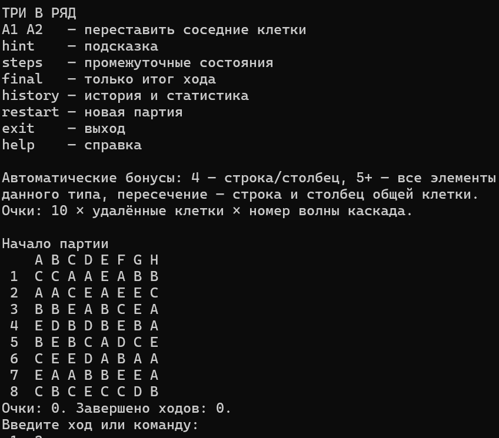
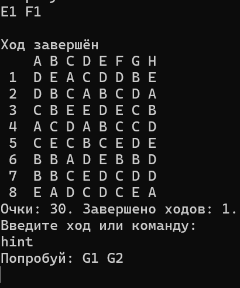

# Derevo - three in a row game

«Три в ряд» — консольная игра на поле 8×8 с элементами пяти типов. Игрок меняет местами соседние элементы, собирая линии из трёх и более одинаковых. Собранные элементы исчезают, приносят очки, а поле заполняется новыми. Цель — набрать как можно больше очков. Игра заканчивается, когда не остаётся доступных ходов.

___

Match-3 is a console game played on an 8×8 board with five types of tiles. Swap adjacent tiles to form lines of three or more matching tiles. Matches disappear, award points, and are replaced by new tiles. The goal is to score as many points as possible before no valid moves remain.

## Скриншоты

# Сборка и запуск derevo

## Программные требования

- Visual Studio с поддержкой .NET 8 и установленным .NET SDK 8.0.
- Зависимости NuGet восстанавливаются при сборке проекта.

## Технические требования

Компьютер с Windows, поддерживающей установленную Visual Studio, клавиатура
и свободное место для проекта и средств разработки. Интернет нужен для
скачивания проекта и зависимостей; сама игра работает без сети.

## Сборка и запуск

1. Скачайте проект и распакуйте архив.
2. Откройте файл `derevo.sln` в Visual Studio.
3. Выберите «Сборка → Собрать решение» и дождитесь успешной сборки.
4. Запустите программу сочетанием Ctrl+F5.

В открывшейся консоли введите `help`, чтобы посмотреть команды игры.
